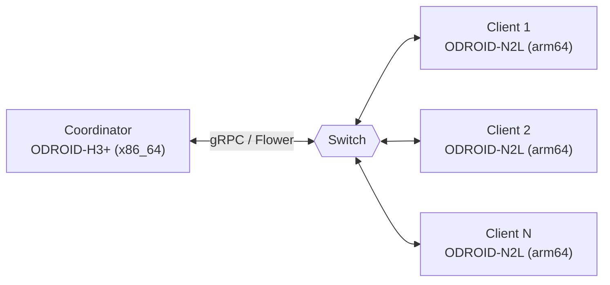

# edge-fl-testbed

[](https://github.com/Abubakar17/edge-fl-testbed/actions/workflows/ci.yml)
[](LICENSE)

A federated learning testbed built on real, heterogeneous edge hardware: one x86_64
coordinator and several arm64 single-board computers. The project works from the bottom
up. It first measures what device-to-device communication costs, then implements
distributed optimization algorithms (ADMM, decentralized gradient descent) from scratch
and checks them against a centralized baseline, and finally runs federated learning with
Flower on non-IID data. Every experiment is configuration-driven and reproducible, and it
runs the same way in a local Docker simulation as on the physical boards.

Project work (6 CFU), University of Genoa. Supervisor: Prof. Giulio Ferro.

## Roadmap

- [x] **Phase 0: Setup.** Repository scaffold and coordinator bring-up. The ODROID-H3 runs the test suite and the Docker simulation. The N2L clients are tracked separately (next line).
- [ ] **Client bring-up (in parallel with Phase 1).** Testbed switch and network are up. N2L #1 (`n2l-1`) is online, gets internet and time from the H3+, and passes `make test` on arm64. Still to do: more boards (Ansible) and the multi-arch image.
- [ ] **Phase 1: Communication.** Devices exchange messages over gRPC. Measure latency, bandwidth and payload cost.
- [ ] **Phase 2: Distributed optimization.** Logistic and least-squares regression with ADMM and decentralized GD in NumPy, compared with a centralized baseline.
- [ ] **Phase 3: Federated learning.** Flower with FedAvg, FedProx and FedADMM on non-IID data, plus update compression or per-round energy measurement.

## Hardware

| Role | Board | CPU / Arch | RAM | Network | Count |
|---|---|---|---|---|---|
| Coordinator / aggregator | ODROID-H3+ | Intel, 4 cores, x86_64; 500 GB NVMe; Ubuntu 22.04 | 8 GB | 2 ports: one to the testbed switch, one to the lab network | 1 (online) |
| Client | ODROID-N2L | Amlogic S922X, arm64 (CPU-only) | 2-4 GB | USB 2.0 Ethernet adapter (about 250-320 Mbit/s max) | 1 online, more pending |
| Switch | TP-Link 16-port | Unmanaged gigabit | - | Testbed subnet 192.168.50.0/24 | 1 |

Client RAM is not confirmed yet. Everything device-specific lives in
[`configs/devices.example.yaml`](configs/devices.example.yaml). How to rebuild the
testbed, including the network, NAT and time sync, is in [`docs/setup.md`](docs/setup.md).

## Architecture



See [`docs/architecture.md`](docs/architecture.md) for more detail.

## Repository layout

```
src/edge_fl/        library code: comms, distopt, fl, metrics, common
experiments/        one folder per phase (config + README)
configs/            YAML configs for devices, network and experiments
deploy/docker/      multi-arch Dockerfile + local simulation (docker-compose)
deploy/ansible/     inventory and provisioning playbook for the boards
tests/              pytest suite
docs/               architecture, testbed setup, engineering log, project tracker
```

## Quickstart (local simulation)

Requirements: [uv](https://docs.astral.sh/uv/), GNU make, and Docker with Compose for the simulation.

```bash
make setup   # create .venv with Python 3.11 + locked deps, install pre-commit hooks
make lint    # ruff + mypy
make test    # pytest
make sim     # build the image and run 1 server + 3 clients with docker compose
```

To use the physical testbed, copy the example configs and fill in your values:

```bash
cp configs/devices.example.yaml configs/devices.yaml
cp deploy/ansible/inventory.example.yaml deploy/ansible/inventory.yaml
```

## Progress

Tasks, a daily log, the hardware inventory and open questions are tracked in
[`docs/project_tracker.xlsx`](docs/project_tracker.xlsx). Engineering notes are in
[`docs/log.md`](docs/log.md).

**2026-11-13: Testbed network (client bring-up)**
- Wired the testbed: H3+, the laptop and the first ODROID-N2L on a dedicated subnet (192.168.50.0/24) through one unmanaged gigabit switch.
- Split the H3+'s two Ethernet ports: one to the testbed switch, one to the lab network for internet.
- Gave the N2Ls internet through NAT on the H3+, and made the H3+ the testbed time server (chrony). The N2Ls have no clock battery, so they need it.
- Brought N2L #1 online on a USB 2.0 Ethernet adapter, because Hardkernel reports USB 3.0 Ethernet adapters as unreliable on the N2L.
- Fixed several problems along the way: the address was on the unplugged port, a stray gateway on the switch profile broke internet, Windows Firewall blocked ping, and TLS failed on the unset N2L clock.
- Made NAT on the H3+ start automatically at boot with a small systemd service.
- Set up N2L #1 (`n2l-1`) with Docker and uv and cloned the repo. `make test` passes, the project's first run on arm64.
- Measured baseline `ping` and `iperf3` for every pair of devices (Phase 1, P1-00). Results are [below](#results).
- Wrote the steps, including a checklist for adding each new N2L, in [`docs/setup.md`](docs/setup.md).

**Next:** the Phase 1 gRPC echo benchmark: payloads from 1 KB to 50 MB, round trips timed on the client, run between the boards.

**2026-11-06: Phase 0 (setup)**
- Scaffolded the repository: uv project on Python 3.11 with locked dependencies, a src layout, CI, pre-commit, a multi-arch Dockerfile, a Compose simulation and Ansible stubs.
- Brought up the ODROID-H3 coordinator: 4 cores, 8 GB RAM, 500 GB NVMe, Ubuntu MATE 22.04. Switched the system language to English.
- Installed the Realtek 8811AU/8821AU Wi-Fi driver. The board now runs on wired Ethernet.
- Set up remote access over SSH and ZeroTier.
- Installed Docker and Compose (with the docker group permission fixed), plus git, make, tmux and uv.
- Cloned the repository on the H3. `make test` passes, and `make sim` starts the server and three clients, which exit cleanly. The code is still placeholder, so nothing trains yet.

## Results

### Phase 1 baseline: raw network (ping + iperf3)

Medians of 3 rounds: 100 pings or a 30 s single-stream TCP test per round. Raw files and
the summary script are in [`experiments/01_communication/baseline/`](experiments/01_communication/baseline/).

| Link | RTT (ms) | TCP throughput (Mbit/s) |
|---|---|---|
| H3+ ↔ N2L | 0.483 | 335.3 (H3+ → N2L), 293.9 (N2L → H3+) |
| H3+ ↔ laptop | 0.734 | 94.9 / 94.8 |
| N2L ↔ laptop | 0.714 | 94.9 / 94.8 |

- **The N2L's USB 2.0 Ethernet adapter limits the board-to-board link** to about 300 Mbit/s, with no packet loss and sub-millisecond RTT. Uploads from the N2L run about 12% slower than downloads.
- **The laptop is capped at 100 Mbit/s by its Fast Ethernet port** (Realtek PCIe FE), so it controls runs but doesn't take part in measurements.
- These figures set the floor for the gRPC benchmark: about 0.48 ms per round trip, and about 0.3 s minimum to send 10 MB from an N2L.

### Phase 1: gRPC between H3+ and N2L

Echo (round trip), upload and download from 1 KB to 50 MB, timed on the client. The code,
run instructions and analysis are in [`experiments/01_communication/`](experiments/01_communication/).

| | 1 KB call | 4 MB | 50 MB | Bandwidth at 50 MB |
|---|---|---|---|---|
| Echo, N2L client | 1.82 ms | 237 ms | 2.97 s | 282 Mbit/s (≈90% of raw TCP) |
| Download to N2L (H3+ → N2L) | 1.71 ms | 112 ms | 1.46 s | 287 Mbit/s (86% of iperf3) |
| Upload from N2L (N2L → H3+) | 1.74 ms | 133 ms | 1.61 s | 261 Mbit/s (89% of iperf3) |

- **Large messages** reach 86–90% of raw TCP. The N2L sends about 8% slower than it receives.
- **Small messages** are set by CPU, not the network. A 1 KB call costs about 1.7 ms with the H3+ as server, but about 3.7 ms with an N2L as server, whichever way the data goes. Decentralized FL needs every N2L to be a server, so this matters there.
- **Latency–bandwidth model** for an echo, N2L client: *time ≈ 1.7 ms + 2 × size ÷ 285 Mbit/s*, within 4% from 1 KB to 50 MB.
- **FL estimate:** with a 4 MB model, an N2L client spends about 245 ms per round on communication.

Results from later phases will be added as each phase is completed.

## License

[MIT](LICENSE) © Syed Muhammad Abubakar
