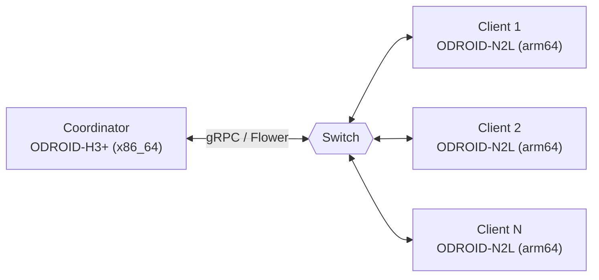

# edge-fl-testbed

[](https://github.com/Abubakar17/edge-fl-testbed/actions/workflows/ci.yml)
[](LICENSE)

A federated learning testbed built on real, heterogeneous edge hardware: one x86_64
coordinator and several arm64 single-board computers. The project works from the bottom
up. It first measures what device-to-device communication costs, then implements
distributed optimization algorithms (ADMM, decentralized gradient descent) from scratch
and checks them against a centralized baseline, and finally runs federated learning with
Flower on non-IID data. Every experiment is configuration-driven and reproducible, and it
runs the same way in a local Docker simulation as on the physical boards.

Project work (6 CFU), University of Genoa. Supervisor: Prof. Giulio Ferro.

## Roadmap

- [x] **Phase 0: Setup.** Repository scaffold and coordinator bring-up. The ODROID-H3 runs the test suite and the Docker simulation. The N2L clients are tracked separately (next line).
- [ ] **Client bring-up (in parallel with Phase 1).** Set up the ODROID-N2L boards with Ansible and run the multi-arch image on them. Waiting for the boards.
- [ ] **Phase 1: Communication.** Devices exchange messages over gRPC. Measure latency, bandwidth and payload cost.
- [ ] **Phase 2: Distributed optimization.** Logistic and least-squares regression with ADMM and decentralized GD in NumPy, compared with a centralized baseline.
- [ ] **Phase 3: Federated learning.** Flower with FedAvg, FedProx and FedADMM on non-IID data, plus update compression or per-round energy measurement.

## Hardware

| Role | Board | CPU / Arch | RAM | Network | Count |
|---|---|---|---|---|---|
| Coordinator / aggregator | ODROID-H3 | Intel, 4 cores, x86_64; 500 GB NVMe; Ubuntu 22.04 | 8 GB | Wired Ethernet | 1 (online) |
| Client | ODROID-N2L | Amlogic S922X, arm64 (CPU-only) | 2-4 GB | 1GbE | TBD (pending) |

The client details are not final yet. Everything device-specific lives in
[`configs/devices.example.yaml`](configs/devices.example.yaml).

## Architecture



See [`docs/architecture.md`](docs/architecture.md) for more detail.

## Repository layout

```
src/edge_fl/        library code: comms, distopt, fl, metrics, common
experiments/        one folder per phase (config + README)
configs/            YAML configs for devices, network and experiments
deploy/docker/      multi-arch Dockerfile + local simulation (docker-compose)
deploy/ansible/     inventory and provisioning playbook for the boards
tests/              pytest suite
docs/               architecture and engineering log
```

## Quickstart (local simulation)

Requirements: [uv](https://docs.astral.sh/uv/), GNU make, and Docker with Compose for the simulation.

```bash
make setup   # create .venv with Python 3.11 + locked deps, install pre-commit hooks
make lint    # ruff + mypy
make test    # pytest
make sim     # build the image and run 1 server + 3 clients with docker compose
```

To use the physical testbed, copy the example configs and fill in your values:

```bash
cp configs/devices.example.yaml configs/devices.yaml
cp deploy/ansible/inventory.example.yaml deploy/ansible/inventory.yaml
```

## Progress

Tasks, a daily log, the hardware inventory and open questions are tracked in
[`docs/project_tracker.xlsx`](docs/project_tracker.xlsx). Engineering notes are in
[`docs/log.md`](docs/log.md).

**2026-11-06: Phase 0 (setup)**
- Scaffolded the repository: uv project on Python 3.11 with locked dependencies, a src layout, CI, pre-commit, a multi-arch Dockerfile, a Compose simulation and Ansible stubs.
- Brought up the ODROID-H3 coordinator: 4 cores, 8 GB RAM, 500 GB NVMe, Ubuntu MATE 22.04. Switched the system language to English.
- Installed the Realtek 8811AU/8821AU Wi-Fi driver. The board now runs on wired Ethernet.
- Set up remote access over SSH and ZeroTier.
- Installed Docker and Compose (with the docker group permission fixed), plus git, make, tmux and uv.
- Cloned the repository on the H3. `make test` passes, and `make sim` starts the server and three clients, which exit cleanly. The code is still placeholder, so nothing trains yet.

**Next:** `docs/setup.md` (setup steps that can be repeated on the N2Ls), then the Phase 1 gRPC echo benchmark (payloads from 1 KB to 10 MB, results to CSV).

## Results

Results will be added as each phase is completed.

## License

[MIT](LICENSE) © Syed Muhammad Abubakar
