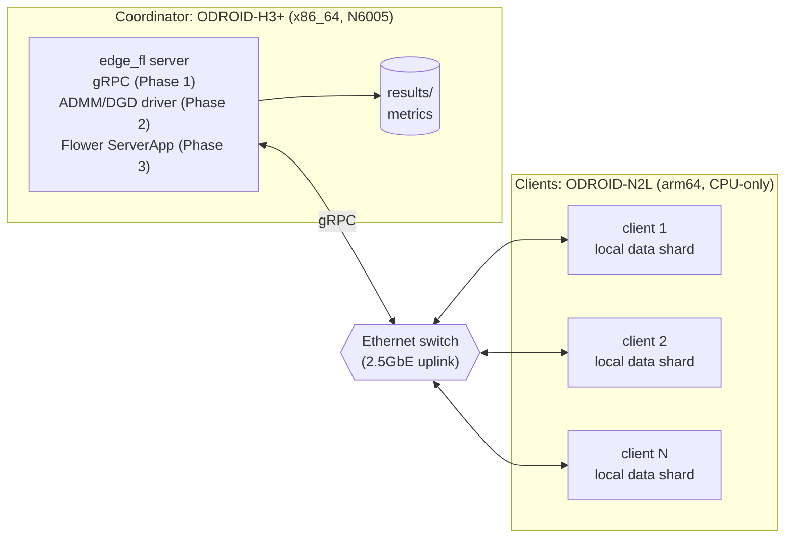

# Architecture

## Physical topology

One x86_64 coordinator aggregates updates from several arm64 clients over wired Ethernet.
The number of boards, their RAM and their addresses come from `configs/devices.yaml`,
never from code.

## Software layers

| Layer | Package | Phase |
|---|---|---|
| Transport and communication benchmarks | `edge_fl.comms` | 1 |
| Distributed optimization (NumPy) | `edge_fl.distopt` | 2 |
| Federated learning (Flower, PyTorch CPU) | `edge_fl.fl` | 3 |
| Measurement (latency, bytes, energy) | `edge_fl.metrics` | all |
| Config, logging, seeding | `edge_fl.common` | all |

## Deployment

- **Local simulation:** `deploy/docker/docker-compose.yml` runs 1 server and 3 clients on
  one machine, with CPU and memory limits set to roughly match an N2L.
- **Physical testbed:** a single multi-arch image (linux/amd64 and linux/arm64) is
  built with buildx. `deploy/ansible/` provisions the boards from an inventory that
  mirrors `configs/devices.yaml`.

## Open questions

- Board count, RAM per board (2 GB or 4 GB) and network layout (switch model, whether the
  H3+'s second NIC is used).
- The Phase 3 differentiator: update compression or per-round energy measurement.
