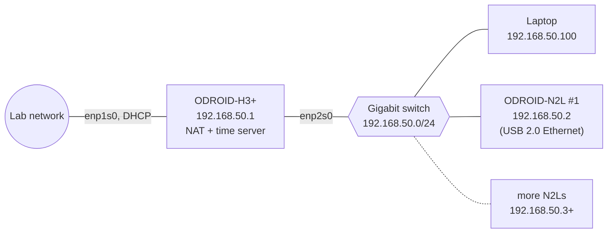
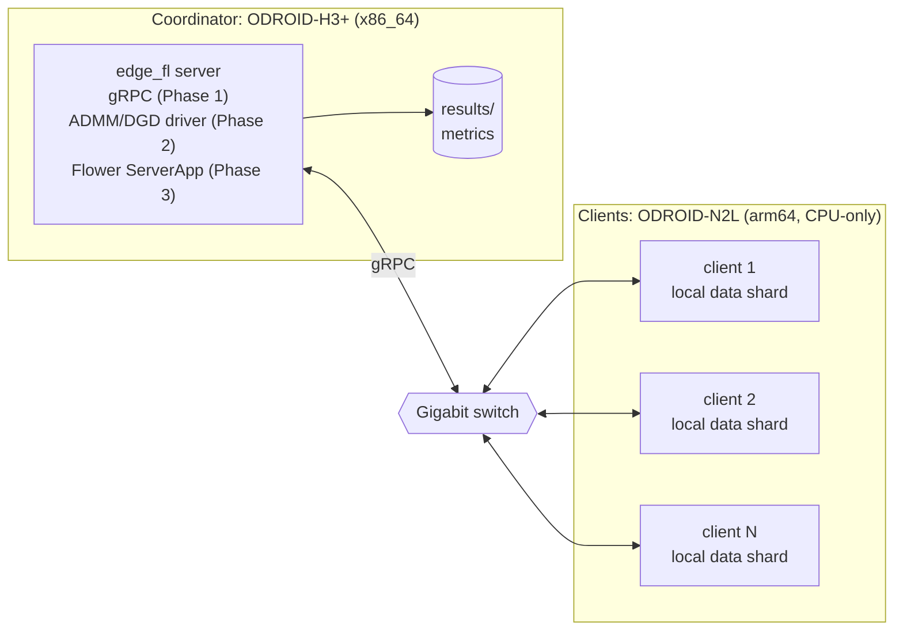

# Architecture

## Physical topology

One x86_64 coordinator works with several arm64 clients over wired Ethernet. The number
of boards, their RAM and their addresses come from `configs/devices.yaml`, never from
code. [`setup.md`](setup.md) has the exact network setup.

### As built

All devices share one unmanaged TP-Link 16-port gigabit switch on the testbed subnet
`192.168.50.0/24`. The H3+ is also the testbed's only route to the internet, through its
second Ethernet port and NAT, and its time server (chrony). The N2Ls have no real-time
clock battery, so they depend on it for the time.

Things to keep in mind for measurements:
- **The N2L links are the slowest.** Each N2L uses a USB 2.0 Ethernet adapter (about 250 to
  320 Mbit/s at most), while the H3+ and the laptop run at 1 Gb/s, so the N2L links will
  likely set the limit on throughput.
- **Clocks agree only to about 0.1 to 1 ms,** the same order as the round-trip times. Measure
  round trips on a single node; never compute one-way delays across boards.

### Logical roles

## Software layers

| Layer | Package | Phase |
|---|---|---|
| Transport and communication benchmarks | `edge_fl.comms` | 1 |
| Distributed optimization (NumPy) | `edge_fl.distopt` | 2 |
| Federated learning (Flower, PyTorch CPU) | `edge_fl.fl` | 3 |
| Measurement (latency, bytes, energy) | `edge_fl.metrics` | all |
| Config, logging, seeding | `edge_fl.common` | all |

## Deployment

- **Local simulation:** `deploy/docker/docker-compose.yml` runs 1 server and 3 clients on
  one machine, with CPU and memory limits set to roughly match an N2L.
- **Physical testbed:** a single multi-arch image (linux/amd64 and linux/arm64) is
  built with buildx. `deploy/ansible/` provisions the boards from an inventory that
  mirrors `configs/devices.yaml`.

## Open questions

- Final board count and RAM per board (2 GB or 4 GB).
- FL topology: centralized first and then decentralized, or decentralized only. To discuss
  with the supervisor.
- The Phase 3 differentiator: update compression or per-round energy measurement.
