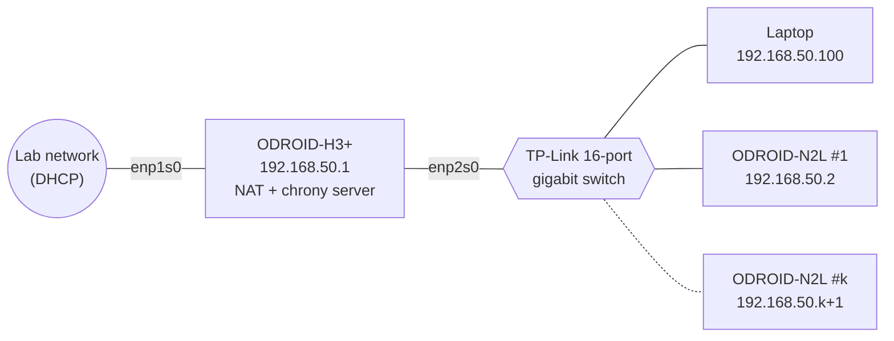

# Testbed setup

How to rebuild the physical testbed from scratch. The steps are written so they can be
repeated for every new board.

## 1. Network layout

All devices sit on a dedicated testbed subnet, `192.168.50.0/24`, on one TP-Link 16-port
gigabit switch. The switch is unmanaged (plug and play).

| Device | Switch port | Interface | Testbed IP | Notes |
|---|---|---|---|---|
| ODROID-H3+ | 1 | `enp2s0` | 192.168.50.1 | Gateway, NAT and time server for the testbed |
| Laptop (Windows) | 2 | Ethernet | 192.168.50.100 | No gateway set, so internet stays on Wi-Fi |
| ODROID-N2L #1 | 3 | `eth0` (USB-Ethernet adapter) | 192.168.50.2 | |
| ODROID-N2L #k | k+2 | `eth0` | 192.168.50.(k+1) | Next free address: .3, .4, ... |



The H3+ has two Ethernet ports:
- **`enp1s0`** connects to the lab network cable and gets an address by DHCP. This is the
  testbed's only route to the internet.
- **`enp2s0`** connects to the switch and holds the static address 192.168.50.1.

The H3+ Wi-Fi is not used. The lab Wi-Fi needs a login page that never appears.

## 2. ODROID-H3+ (coordinator)

### Base install
Ubuntu MATE 22.04 with the system language switched to English. Installed: SSH server,
ZeroTier (remote access from outside the lab), Docker and Compose (user added to the
`docker` group), git, make, curl, tmux and uv. The repo is cloned to `~/edge-fl-testbed`;
`make test` and `make sim` both pass.

### Testbed address on the switch port
The address must sit on the profile bound to `enp2s0`, the port that is plugged in. The
profile names are in Italian.

```bash
nmcli con show                                   # find the profile on enp2s0
sudo nmcli con mod "Connessione via cavo 2" +ipv4.addresses 192.168.50.1/24
# The switch profile must not install a default route, or it hijacks internet traffic:
sudo nmcli con mod "Connessione via cavo 2" ipv4.gateway "" ipv4.never-default yes
sudo nmcli con up "Connessione via cavo 2"
```

### Internet sharing for the N2Ls (NAT), automatic at boot
The rules the H3+ needs:

```bash
sudo sysctl -w net.ipv4.ip_forward=1
sudo iptables -t nat -A POSTROUTING -o enp1s0 -j MASQUERADE
sudo iptables -I FORWARD 1 -i enp2s0 -o enp1s0 -j ACCEPT
sudo iptables -I FORWARD 1 -i enp1s0 -o enp2s0 -m state --state RELATED,ESTABLISHED -j ACCEPT
```

`-I FORWARD 1` inserts the rules at the top of the chain, because Docker's rules on the H3+
drop forwarded traffic by default.

They are applied automatically at boot by three pieces:
- `/etc/sysctl.d/99-testbed-nat.conf` sets `net.ipv4.ip_forward=1`.
- `/usr/local/sbin/testbed-nat.sh` adds the three rules above. It checks first, so it never
  adds duplicates.
- `testbed-nat.service` (systemd) runs the script at boot, after Docker.

`iptables-persistent` was deliberately not used: it would also save and restore Docker's
own rules, creating duplicates.

**Nothing needs doing after a reboot.** Only if an N2L loses internet:

```bash
systemctl status testbed-nat --no-pager          # should be active (exited)
sysctl net.ipv4.ip_forward                       # should be 1
sudo iptables -t nat -S POSTROUTING | grep enp1s0
sudo systemctl restart testbed-nat               # re-applies the rules
```

### Time server (chrony)
The N2Ls have no real-time clock battery, so they lose the time at every power-off. The
H3+ serves time to the testbed.

```bash
sudo apt install -y chrony
printf "allow 192.168.50.0/24\nlocal stratum 10\n" | sudo tee -a /etc/chrony/chrony.conf
sudo systemctl restart chrony
```

## 3. Laptop (Windows)

- Wired Ethernet with the static address 192.168.50.100/24 and **no gateway**, so internet
  stays on Wi-Fi.
- Windows Firewall blocks ping by default. Allow it from an admin PowerShell:
  ```powershell
  New-NetFirewallRule -DisplayName "Allow ping" -Protocol ICMPv4 -IcmpType 8 -Direction Inbound -Action Allow
  ```

## 4. Adding an ODROID-N2L

Use the next free address (.3, .4, ...) and hostname (`n2l-2`, `n2l-3`, ...).

1. **Plug the USB-Ethernet adapter into the white USB 2.0 port**, not the blue USB 3.0 one.
   Hardkernel notes that USB 3.0 Ethernet adapters are unreliable on the N2L. Check with
   `lsusb -t`: the `r8152` line should say `480M`. Expect about 300 Mbit/s (n2l-1 measured
   294 Mbit/s sending and 335 receiving).
2. For the first boot, attach an HDMI monitor and a USB keyboard (in the other port). Log
   in with the default ODROID credentials.
3. Enable SSH: `sudo systemctl enable --now ssh`
4. Set a unique hostname, and update `/etc/hosts` to match:
   ```bash
   sudo hostnamectl set-hostname n2l-2
   sudo sed -i 's/127.0.1.1.*/127.0.1.1\tn2l-2/' /etc/hosts
   ```
5. Find the wired profile with `nmcli con show`. Look for the ethernet line on device
   `eth0` or `enx...`; the profile names are in Italian.
6. Set the static IP, gateway (the H3+) and DNS:
   ```bash
   sudo nmcli con mod "Connessione via cavo 1" ipv4.method manual \
       ipv4.addresses 192.168.50.N/24 ipv4.gateway 192.168.50.1 ipv4.dns "8.8.8.8 1.1.1.1"
   sudo nmcli con up "Connessione via cavo 1"
   ```
7. Test the link: `ping 192.168.50.1` from the board, then `ssh odroid@192.168.50.N` from
   the laptop.
8. Set the clock once by hand. apt refuses to work while the clock is wrong (TLS reports
   "certificate not yet valid"):
   ```bash
   sudo date -s "$(curl -sI http://www.google.com | grep -i '^date:' | cut -d' ' -f2-)"
   ```
9. Test internet with `curl -I https://www.google.com`. The H3+ must be on, with NAT active.
10. Make the board a chrony client of the H3+:
    ```bash
    sudo apt install -y chrony
    sudo sed -i 's/^pool/#pool/; s/^server/#server/' /etc/chrony/chrony.conf
    sudo sed -i 's/^makestep.*/makestep 1 -1/' /etc/chrony/chrony.conf
    echo "server 192.168.50.1 iburst" | sudo tee -a /etc/chrony/chrony.conf
    sudo systemctl restart chrony
    ```
    After a minute or two, `chronyc sources` should show `^*` next to 192.168.50.1.
11. Install the software:
    ```bash
    conda config --set auto_activate_base false     # only if conda is installed; it clashes with uv
    sudo apt update && sudo apt install -y git make curl iperf3
    curl -fsSL https://get.docker.com | sudo sh && sudo usermod -aG docker $USER
    curl -LsSf https://astral.sh/uv/install.sh | sh
    ```
    Log out and back in, run `docker run --rm hello-world`, clone the repo, and run `make test`.
12. Add the new node to `/etc/hosts` on every machine.

## 5. Gotchas

- **The lab network blocks ping.** Test internet with `curl`, not `ping`.
- **N2L internet depends on the H3+** being on, with the NAT rules active.
- **Clock agreement is about 0.1 to 1 ms**, the same order of magnitude as the round-trip
  times. Always measure a round trip on a single node. Never compute a one-way delay from
  two boards' timestamps.
- **"Destination Host Unreachable" from the H3+** usually means the address is on the
  unplugged port. Check which interface the profile is bound to.

- **The laptop's Ethernet port is 100 Mbit/s** (Realtek PCIe FE), so it controls runs but
  isn't used to measure anything. Measure between the boards.

## 6. Baseline measurements

The reference for every Phase 1 result. Raw files and the summary script are in
`experiments/01_communication/baseline/`.

- Install iperf3 with apt on the boards. On the laptop, the Windows build is in `C:\iperf3`,
  which is on the user PATH.
- Start a server on each board with `iperf3 -s -D`. The laptop is always the client; `-R`
  reverses the direction, so no firewall change is needed.
- Pings always run from a Linux board.
- Each test runs 3 rounds: 100 pings, or a 30 s TCP test, per round. Save the files as
  UTF-8 in `baseline/`.
- Run `python experiments/01_communication/summarize_baseline.py experiments/01_communication/baseline`.
  It prints the table and writes `baseline_summary.csv` (medians of the 3 rounds).

## 7. Status

- [x] H3+ NAT and `ip_forward` start automatically at boot (`testbed-nat.service`).
- [x] n2l-1: hostname, Docker, uv, repo cloned, `make test` passes.
- [x] Baseline `ping` and `iperf3` for every pair of devices.
- [ ] Repeat section 4 for each new N2L.
